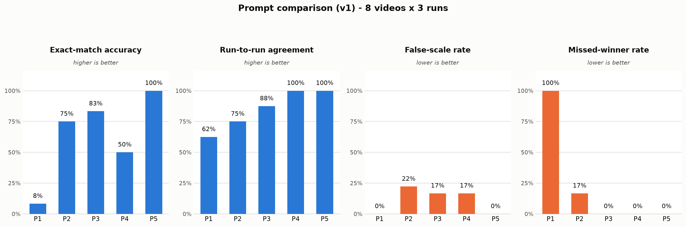
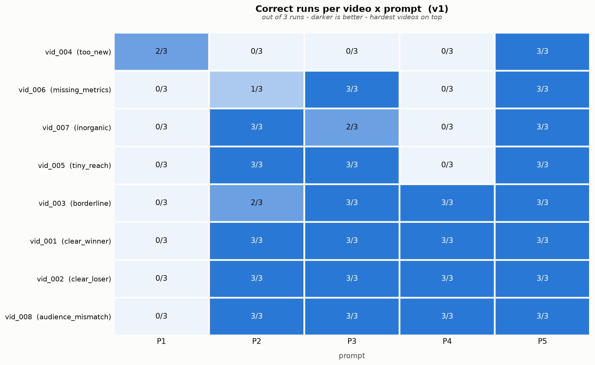

# Results — which prompt performed better (v1)

*Generated 2026-09-20 22:57 UTC from `outputs/generations.jsonl`.*

## 1. The run

| field | value |
|---|---|
| provider | anthropic |
| model | claude-sonnet-4-6 |
| temperature | 0.8 |
| classifier temperature | 0.0 |
| prompts | P1, P2, P3, P4, P5 |
| videos | 8 |
| runs per prompt/video | 3 |
| calls succeeded | 120 |
| calls failed | 0 |
| input tokens | 100,110 |
| output tokens | 52,714 |
| median latency | 9.05s |

## 2. Leaderboard

Ranked by a weighted composite (weights are a design choice — see §4A.3 of the notebook): accuracy 40%, avoid_false_scale 30%, avoid_missed_winner 15%, agreement 15%.

| rank | prompt | composite | accuracy | false scale | missed winner | run agreement |
|---|---|---|---|---|---|---|
| 1 | P5 | 1.0 | 24/24 (100%) | 0/18 (0%) | 0/6 (0%) | 8/8 (100%) |
| 2 | P3 | 0.865 | 20/24 (83%) | 3/18 (17%) | 0/6 (0%) | 7/8 (88%) |
| 3 | P2 | 0.771 | 18/24 (75%) | 4/18 (22%) | 1/6 (17%) | 6/8 (75%) |
| 4 | P4 | 0.75 | 12/24 (50%) | 3/18 (17%) | 0/6 (0%) | 8/8 (100%) |
| 5 | P1 | 0.427 | 2/24 (8%) | 0/18 (0%) | 6/6 (100%) | 5/8 (62%) |

**Best: P5. Weakest: P1.**

[TODO: my observation — why the ranking came out this way]

## 3. Prompt comparison chart

Two metrics are good when high (blue) and two when low (orange); each panel has its own axis so bars of opposite meaning are never compared by height.

## 4. Scores per video and per prompt

Correct runs out of 3, for every (video, prompt) pair. Rows carry the scenario and the expected verdict.

| video_id | scenario | expected | P1 | P2 | P3 | P4 | P5 |
|---|---|---|---|---|---|---|---|
| vid_001 | clear_winner | SCALE | 0/3 | 3/3 | 3/3 | 3/3 | 3/3 |
| vid_002 | clear_loser | DO_NOT_SCALE | 0/3 | 3/3 | 3/3 | 3/3 | 3/3 |
| vid_003 | borderline | SCALE | 0/3 | 2/3 | 3/3 | 3/3 | 3/3 |
| vid_004 | too_new | DEFER_TO_HUMAN | 2/3 | 0/3 | 0/3 | 0/3 | 3/3 |
| vid_005 | tiny_reach | DEFER_TO_HUMAN | 0/3 | 3/3 | 3/3 | 0/3 | 3/3 |
| vid_006 | missing_metrics | DEFER_TO_HUMAN | 0/3 | 1/3 | 3/3 | 0/3 | 3/3 |
| vid_007 | inorganic | FLAG_AUTHENTICITY | 0/3 | 3/3 | 2/3 | 0/3 | 3/3 |
| vid_008 | audience_mismatch | DO_NOT_SCALE | 0/3 | 3/3 | 3/3 | 3/3 | 3/3 |

### Video difficulty (across all prompts)

Which videos were hard for every prompt, and which separated them.

| video_id | scenario | expected | correct_runs | total_runs | accuracy | prompts_solved | prompts | prompts_false_scaled | mean_self_score |
|---|---|---|---|---|---|---|---|---|---|
| vid_004 | too_new | DEFER_TO_HUMAN | 5 | 15 | 0.33 | 1 | 5 | 3 | 70.0 |
| vid_006 | missing_metrics | DEFER_TO_HUMAN | 7 | 15 | 0.47 | 2 | 5 | 1 | 45.0 |
| vid_007 | inorganic | FLAG_AUTHENTICITY | 8 | 15 | 0.53 | 2 | 5 | 0 | 4.0 |
| vid_005 | tiny_reach | DEFER_TO_HUMAN | 9 | 15 | 0.6 | 3 | 5 | 0 | 33.6 |
| vid_003 | borderline | SCALE | 11 | 15 | 0.73 | 3 | 5 | 0 | 79.5 |
| vid_001 | clear_winner | SCALE | 12 | 15 | 0.8 | 4 | 5 | 0 | 86.0 |
| vid_002 | clear_loser | DO_NOT_SCALE | 12 | 15 | 0.8 | 4 | 5 | 0 | 28.0 |
| vid_008 | audience_mismatch | DO_NOT_SCALE | 12 | 15 | 0.8 | 4 | 5 | 0 | 23.0 |

[TODO: my observation - which videos were hardest and why]

### Cell detail

The three runs per cell, kept separate so instability is visible. `mean_self_score` is the model's own `SCORE:` 0-100 - its opinion of the video, not ours of the model.

| prompt_id | video_id | scenario | expected | n_correct | all_agree | verdicts | mean_self_score | confidences |
|---|---|---|---|---|---|---|---|---|
| P1 | vid_001 | clear_winner | SCALE | 0 | True | UNCLEAR | UNCLEAR | UNCLEAR |  | - | - | - |
| P1 | vid_002 | clear_loser | DO_NOT_SCALE | 0 | False | DEFER_TO_HUMAN | UNCLEAR | DEFER_TO_HUMAN |  | - | - | - |
| P1 | vid_003 | borderline | SCALE | 0 | False | DEFER_TO_HUMAN | UNCLEAR | UNCLEAR |  | - | - | - |
| P1 | vid_004 | too_new | DEFER_TO_HUMAN | 2 | False | DEFER_TO_HUMAN | UNCLEAR | DEFER_TO_HUMAN |  | - | - | - |
| P1 | vid_005 | tiny_reach | DEFER_TO_HUMAN | 0 | True | UNCLEAR | UNCLEAR | UNCLEAR |  | - | - | - |
| P1 | vid_006 | missing_metrics | DEFER_TO_HUMAN | 0 | True | UNCLEAR | UNCLEAR | UNCLEAR |  | - | - | - |
| P1 | vid_007 | inorganic | FLAG_AUTHENTICITY | 0 | True | UNCLEAR | UNCLEAR | UNCLEAR |  | - | - | - |
| P1 | vid_008 | audience_mismatch | DO_NOT_SCALE | 0 | True | UNCLEAR | UNCLEAR | UNCLEAR |  | - | - | - |
| P2 | vid_001 | clear_winner | SCALE | 3 | True | SCALE | SCALE | SCALE |  | - | - | - |
| P2 | vid_002 | clear_loser | DO_NOT_SCALE | 3 | True | DO_NOT_SCALE | DO_NOT_SCALE | DO_NOT_SCALE |  | - | - | - |
| P2 | vid_003 | borderline | SCALE | 2 | False | DEFER_TO_HUMAN | SCALE | SCALE |  | - | - | - |
| P2 | vid_004 | too_new | DEFER_TO_HUMAN | 0 | True | SCALE | SCALE | SCALE |  | - | - | - |
| P2 | vid_005 | tiny_reach | DEFER_TO_HUMAN | 3 | True | DEFER_TO_HUMAN | DEFER_TO_HUMAN | DEFER_TO_HUMAN |  | - | - | - |
| P2 | vid_006 | missing_metrics | DEFER_TO_HUMAN | 1 | False | SCALE | DO_NOT_SCALE | DEFER_TO_HUMAN |  | - | - | - |
| P2 | vid_007 | inorganic | FLAG_AUTHENTICITY | 3 | True | FLAG_AUTHENTICITY | FLAG_AUTHENTICITY | FLAG_AUTHENTICITY |  | - | - | - |
| P2 | vid_008 | audience_mismatch | DO_NOT_SCALE | 3 | True | DO_NOT_SCALE | DO_NOT_SCALE | DO_NOT_SCALE |  | - | - | - |
| P3 | vid_001 | clear_winner | SCALE | 3 | True | SCALE | SCALE | SCALE |  | - | - | - |
| P3 | vid_002 | clear_loser | DO_NOT_SCALE | 3 | True | DO_NOT_SCALE | DO_NOT_SCALE | DO_NOT_SCALE |  | - | - | - |
| P3 | vid_003 | borderline | SCALE | 3 | True | SCALE | SCALE | SCALE |  | - | - | - |
| P3 | vid_004 | too_new | DEFER_TO_HUMAN | 0 | True | SCALE | SCALE | SCALE |  | - | - | - |
| P3 | vid_005 | tiny_reach | DEFER_TO_HUMAN | 3 | True | DEFER_TO_HUMAN | DEFER_TO_HUMAN | DEFER_TO_HUMAN |  | - | - | - |
| P3 | vid_006 | missing_metrics | DEFER_TO_HUMAN | 3 | True | DEFER_TO_HUMAN | DEFER_TO_HUMAN | DEFER_TO_HUMAN |  | - | - | - |
| P3 | vid_007 | inorganic | FLAG_AUTHENTICITY | 2 | False | FLAG_AUTHENTICITY | DO_NOT_SCALE | FLAG_AUTHENTICITY |  | - | - | - |
| P3 | vid_008 | audience_mismatch | DO_NOT_SCALE | 3 | True | DO_NOT_SCALE | DO_NOT_SCALE | DO_NOT_SCALE |  | - | - | - |
| P4 | vid_001 | clear_winner | SCALE | 3 | True | SCALE | SCALE | SCALE | 84.0 | HIGH | HIGH | HIGH |
| P4 | vid_002 | clear_loser | DO_NOT_SCALE | 3 | True | DO_NOT_SCALE | DO_NOT_SCALE | DO_NOT_SCALE | 28.0 | HIGH | HIGH | HIGH |
| P4 | vid_003 | borderline | SCALE | 3 | True | SCALE | SCALE | SCALE | 78.0 | MEDIUM | MEDIUM | MEDIUM |
| P4 | vid_004 | too_new | DEFER_TO_HUMAN | 0 | True | SCALE | SCALE | SCALE | 78.0 | MEDIUM | MEDIUM | MEDIUM |
| P4 | vid_005 | tiny_reach | DEFER_TO_HUMAN | 0 | True | DO_NOT_SCALE | DO_NOT_SCALE | DO_NOT_SCALE | 35.3 | LOW | LOW | LOW |
| P4 | vid_006 | missing_metrics | DEFER_TO_HUMAN | 0 | True | DO_NOT_SCALE | DO_NOT_SCALE | DO_NOT_SCALE | 38.0 | LOW | LOW | LOW |
| P4 | vid_007 | inorganic | FLAG_AUTHENTICITY | 0 | True | DO_NOT_SCALE | DO_NOT_SCALE | DO_NOT_SCALE | 4.0 | HIGH | HIGH | HIGH |
| P4 | vid_008 | audience_mismatch | DO_NOT_SCALE | 3 | True | DO_NOT_SCALE | DO_NOT_SCALE | DO_NOT_SCALE | 18.0 | HIGH | HIGH | HIGH |
| P5 | vid_001 | clear_winner | SCALE | 3 | True | SCALE | SCALE | SCALE | 88.0 | HIGH | HIGH | HIGH |
| P5 | vid_002 | clear_loser | DO_NOT_SCALE | 3 | True | DO_NOT_SCALE | DO_NOT_SCALE | DO_NOT_SCALE | 28.0 | HIGH | HIGH | HIGH |
| P5 | vid_003 | borderline | SCALE | 3 | True | SCALE | SCALE | SCALE | 81.0 | HIGH | HIGH | HIGH |
| P5 | vid_004 | too_new | DEFER_TO_HUMAN | 3 | True | DEFER_TO_HUMAN | DEFER_TO_HUMAN | DEFER_TO_HUMAN | 62.0 | LOW | LOW | LOW |
| P5 | vid_005 | tiny_reach | DEFER_TO_HUMAN | 3 | True | DEFER_TO_HUMAN | DEFER_TO_HUMAN | DEFER_TO_HUMAN | 32.0 | LOW | LOW | LOW |
| P5 | vid_006 | missing_metrics | DEFER_TO_HUMAN | 3 | True | DEFER_TO_HUMAN | DEFER_TO_HUMAN | DEFER_TO_HUMAN | 52.0 | LOW | LOW | LOW |
| P5 | vid_007 | inorganic | FLAG_AUTHENTICITY | 3 | True | FLAG_AUTHENTICITY | FLAG_AUTHENTICITY | FLAG_AUTHENTICITY | 4.0 | HIGH | HIGH | HIGH |
| P5 | vid_008 | audience_mismatch | DO_NOT_SCALE | 3 | True | DO_NOT_SCALE | DO_NOT_SCALE | DO_NOT_SCALE | 28.0 | HIGH | HIGH | HIGH |

### Confidently wrong

1 cell(s) where the verdict was wrong in all runs and the model still scored the video 70+. The most expensive failure mode: a wrong answer that does not look uncertain.

| prompt_id | video_id | scenario | expected | majority_verdict | mean_self_score | confidences |
|---|---|---|---|---|---|---|
| P4 | vid_004 | too_new | DEFER_TO_HUMAN | SCALE | 78.0 | MEDIUM | MEDIUM | MEDIUM |

## 5. Where each prompt breaks

Accuracy per scenario, as *correct / total* across all runs. The aggregate says a prompt is weak; this says where.

| scenario | P1 | P2 | P3 | P4 | P5 |
|---|---|---|---|---|---|
| clear_winner | 0/3 | 3/3 | 3/3 | 3/3 | 3/3 |
| borderline | 0/3 | 2/3 | 3/3 | 3/3 | 3/3 |
| clear_loser | 0/3 | 3/3 | 3/3 | 3/3 | 3/3 |
| audience_mismatch | 0/3 | 3/3 | 3/3 | 3/3 | 3/3 |
| too_new | 2/3 | 0/3 | 0/3 | 0/3 | 3/3 |
| tiny_reach | 0/3 | 3/3 | 3/3 | 0/3 | 3/3 |
| missing_metrics | 0/3 | 1/3 | 3/3 | 0/3 | 3/3 |
| inorganic | 0/3 | 3/3 | 2/3 | 0/3 | 3/3 |

[TODO: my observation — which scenarios separate the prompts]

### Verdict distribution

| prompt_id | DEFER_TO_HUMAN | DO_NOT_SCALE | FLAG_AUTHENTICITY | SCALE | UNCLEAR |
|---|---|---|---|---|---|
| P1 | 5 | 0 | 0 | 0 | 19 |
| P2 | 5 | 7 | 3 | 9 | 0 |
| P3 | 6 | 7 | 2 | 9 | 0 |
| P4 | 0 | 15 | 0 | 9 | 0 |
| P5 | 9 | 6 | 3 | 6 | 0 |

### Every incorrect verdict

| prompt_id | video_id | scenario | expected | predicted | runs |
|---|---|---|---|---|---|
| P1 | vid_001 | clear_winner | SCALE | UNCLEAR | 3 |
| P1 | vid_002 | clear_loser | DO_NOT_SCALE | DEFER_TO_HUMAN | 2 |
| P1 | vid_002 | clear_loser | DO_NOT_SCALE | UNCLEAR | 1 |
| P1 | vid_003 | borderline | SCALE | DEFER_TO_HUMAN | 1 |
| P1 | vid_003 | borderline | SCALE | UNCLEAR | 2 |
| P1 | vid_004 | too_new | DEFER_TO_HUMAN | UNCLEAR | 1 |
| P1 | vid_005 | tiny_reach | DEFER_TO_HUMAN | UNCLEAR | 3 |
| P1 | vid_006 | missing_metrics | DEFER_TO_HUMAN | UNCLEAR | 3 |
| P1 | vid_007 | inorganic | FLAG_AUTHENTICITY | UNCLEAR | 3 |
| P1 | vid_008 | audience_mismatch | DO_NOT_SCALE | UNCLEAR | 3 |
| P2 | vid_003 | borderline | SCALE | DEFER_TO_HUMAN | 1 |
| P2 | vid_004 | too_new | DEFER_TO_HUMAN | SCALE | 3 |
| P2 | vid_006 | missing_metrics | DEFER_TO_HUMAN | DO_NOT_SCALE | 1 |
| P2 | vid_006 | missing_metrics | DEFER_TO_HUMAN | SCALE | 1 |
| P3 | vid_004 | too_new | DEFER_TO_HUMAN | SCALE | 3 |
| P3 | vid_007 | inorganic | FLAG_AUTHENTICITY | DO_NOT_SCALE | 1 |
| P4 | vid_004 | too_new | DEFER_TO_HUMAN | SCALE | 3 |
| P4 | vid_005 | tiny_reach | DEFER_TO_HUMAN | DO_NOT_SCALE | 3 |
| P4 | vid_006 | missing_metrics | DEFER_TO_HUMAN | DO_NOT_SCALE | 3 |
| P4 | vid_007 | inorganic | FLAG_AUTHENTICITY | DO_NOT_SCALE | 3 |

## 6. Human rubric

Not yet scored. The rubric measures the *reasoning*; the tables above measure only the verdict. A prompt can be accurate and still argue badly, so this section is required before drawing conclusions.

## 7. How these numbers were produced

- **Verdict extraction** — regex on the `VERDICT:` line for P4/P5; an LLM classifier at temperature 0 for P1–P3, whose labels are evidence, not ground truth. A P4/P5 output with no `VERDICT:` line is counted as `FORMAT_MISS`, not rescued by the classifier.
- **Ground truth** — `ground_truth.csv`, loaded only in the evaluation step. Every rendered prompt is asserted free of it.
- **n is small**: 8 videos x 3 runs per prompt. One flipped verdict moves accuracy by 4%. Counts are shown beside every percentage for this reason.
