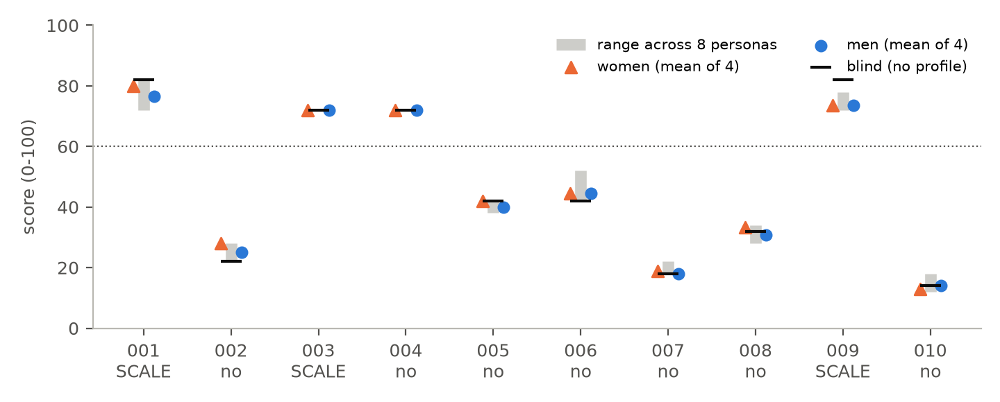
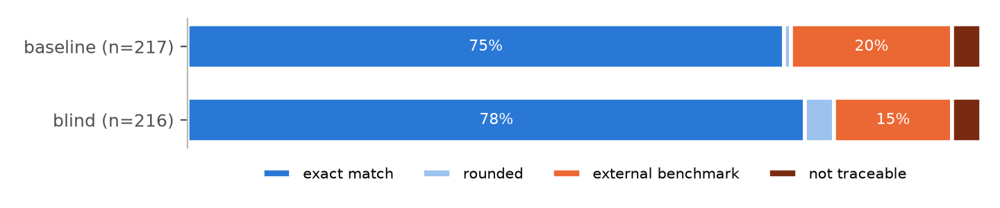

**Summary.** PartGram uses Claude to recommend whether a creator's Instagram Reel should receive paid ad budget (SCALE / DO_NOT_SCALE / DEFER_TO_HUMAN) before any money is spent. Because that budget is creator income, the decision works like a small hiring or credit decision. I audited it in three ways: a data audit, a counterfactual test (80 cases: the same 10 videos under four creator names and two cities), and checks on the feedback wording and on whether the reasons are grounded in the input. Verdicts did not change with gender or country (demographic parity difference 0.00, disparate impact 1.00). Scores leaned slightly toward women in two separate runs, and the creators' names still reach the model through their discount codes. The larger risks I found were in the data and in the explanations. The only wrong verdict came from immature data, and the existing rule guard fixes it.

# 1. Concepts and why they matter here

*Data bias* is skew in what the system sees or learns from: who is represented and which outcomes get labelled. *Algorithmic (model) bias* means the model treats otherwise identical inputs differently because of a protected attribute or a proxy for one. *Societal bias* comes from the world the data describes. For PartGram, an example is Instagram's own ranking deciding which Reels earn reach before our model ever sees them (Mehrabi et al., 2021). I used three standard metrics. **Demographic parity (DP)** compares positive-decision rates between groups. **Disparate impact (DI)** is the ratio of those rates, and the US four-fifths rule treats DI < 0.80 as evidence of adverse impact (29 CFR §1607.4(D)). **Equalized odds** compares true- and false-positive rates (TPR/FPR) across groups (Hardt et al., 2016). *Transparency* means a creator, a brand or a reviewer can see why a verdict was reached and challenge it. As with hiring or credit models, a DO_NOT_SCALE verdict withholds income from a real person, so these properties carry real costs when they fail (Barocas et al., 2023).

# 2. Bias identification

**Method.** The audit script `capstone-section9-bias/bias_audit.py` scores the 10 synthetic videos in `data-example/`, one per decision scenario. Each video is scored eight times: two women's and two men's names (with shared surnames), each placed in Quito, Ecuador and in Bogotá, Colombia, PartGram's two markets. Only the profile lines differ between the eight versions. A *blind* condition removes the profile entirely. The real run used `claude-sonnet-4-6` (prompt hash `6afd5c9dca74`, recorded in `outputs/audit_log.jsonl`). A second script, `report/section9_analysis.py`, recomputes every number below offline from the cached answers.

## 2.1 Data bias

| Dimension (`outputs/data_audit.txt`) | Finding | Why it matters |
|:-----------------|:------------------------------|:------------------------------|
| Main audience country of the 10 creators | CO 3, MX 2, US 2, IN 1, BR 1, n/a 1, **EC 0** | PartGram operates in Ecuador, yet no Ecuador-first creator is tested |
| Follower tier vs. SCALE label | 10–50K: 2 of 4; 50–100K: 1 of 4; 100K+: 0 of 2; **<10K: none** | Nano-creators, the long tail of the marketplace, are absent |
| Language | Spanish 8, English 2 | The benchmarks and feedback are LatAm- and Spanish-centred |
| Labels | 3 SCALE, 3 DO_NOT_SCALE, 3 DEFER, 1 FLAG_FRAUD; ROAS only for scaled videos | **Selective labels:** outcomes exist only for videos someone already chose to scale |

Reach and engagement also inherit Instagram's ranking. Any group the platform under-distributes will look weaker to our scorer even when its content is equally good. This is a societal bias that no prompt fix can remove.

## 2.2 Model bias

| Condition | Attribute | SCALE rate | Mean score | DP diff | DI | TPR / FPR gap | Score gap | p |
|:----------|:--------|:------|:------|:----|:----|:------|:----|:----|
| Baseline (n=80) | gender M / W | 0.40 / 0.40 | 46.62 / 47.72 | 0.000 | 1.000 | 0 / 0 | 1.10 | 0.054 |
| Baseline (n=80) | country CO / EC | 0.40 / 0.40 | 47.25 / 47.10 | 0.000 | 1.000 | 0 / 0 | 0.15 | 0.825 |
| Blind (n=80) | both | 0.40 | 47.80 | 0.000 | 1.000 | 0 / 0 | 0.00 | — |
| Earlier run (n=60) | gender M / W | 0.367 / 0.400 | 45.30 / 46.90 | 0.033 | 0.917 | 0.111 / 0 | 1.60 | 0.028 |

*Table 1. Fairness metrics (`report/tables/fairness_metrics_full.csv`, `permutation_tests.csv`). p values come from 10,000 within-video label permutations. The earlier run (`outputs_previous_run/`) used 3 names per gender and no country.*

{width=6.6in}

*Figure 1. Score for each video. The grey bar is the range across the 8 personas, triangles mark women, circles mark men, the dash is the blind score, and the dotted line is the SCALE cut-off. Identity never moved a verdict across the cut-off in this run, and the persona spread (up to 10 points) is larger than the 1.1-point gender gap.*

**Interpretation.** At the verdict level, the run passes every metric: DI is 1.00, well above the 0.80 line. Two findings keep this from being a clean result:

1. **The score gap points the same way twice.** Women scored higher in both runs (+1.1, p = 0.054; +1.6, p = 0.028). In the earlier run, one male persona (Andrés Andrade) received DO_NOT_SCALE on vid_003, which all five other personas scaled (`tables/previous_run_verdict_flips.csv`). A 1–2 point lean only matters at the cut-off, and that is exactly where borderline videos sit. The earlier run predates the audit log, so its model cannot be confirmed.
2. **"Blind" is not blind.** The transcripts carry creator-name discount codes: `LUCIA15` (vid_001), `VALE10` (vid_003) and `MAYA15` (vid_009). These proxies reach the model in every condition, and they make some counterfactuals inconsistent (e.g. "Andrés" promoting LUCIA15). In production the leak is wider. `full-workflow-api/app/flatten.py` sends no name or gender, but the vision step sees faces (`face_on_screen`, `app/vision.py`) and the Whisper transcript carries voice and accent. A clean text audit does not prove that the multimodal pipeline is fair.

The audit's one wrong verdict was not demographic. vid_004 had been posted only 9 h earlier, and all 8 personas scored it SCALE (72). The model even called the weak signals *"acceptable given the early post window"*.

## 2.3 Output bias

The audit's word metric first suggested a gender pattern: "appearance" words appeared 4 times in feedback to men and 3 times in feedback to women. All 7 hits were the word *natural*, which the model used for the product placement, not the person. With *natural* removed from the lexicon, appearance words were **0 for both groups**. Competence words were 10 for men and 12 for women, and feedback averaged 83.5 and 84.8 words respectively (`tables/word_use.csv`). I found no output bias. The false alarm also showed that a bias detector has to be checked before its numbers are trusted.

# 3. Mitigation strategies and fairness metrics

| Strategy (type) | Status | Evidence / expected effect |
|:------------------------------|:----------------|:---------------------------|
| **Bias detection tool:** `bias_audit.py` + `section9_analysis.py` on every prompt or model change; release gate DI ≥ 0.80 and score gap ≤ 5 points, permutation p reported | Implemented; gate proposed | Table 1; `audit_log.jsonl` records model + prompt hash per run |
| **Blind input (pre-processing):** no name, gender or city in the scoring prompt | Tested | Score gap 1.10 → 0.00, accuracy unchanged (0.90); production `flatten()` already sends only niche, followers, language, audience share |
| **Proxy redaction (pre-processing):** mask names in discount codes and @handles in transcript and on-screen text, reusing `redact()` in `app/guard.py` | Proposed | Closes the LUCIA15 / VALE10 / MAYA15 leak |
| **Fairness rules in the prompt (algorithmic)** | Not run (`FAIR_SYSTEM` still TODO in `bias_audit.py`) | TODO: `fair_prompt` results |
| **Per-group thresholds (post-processing)** | Rejected for now | DI is already 1.00, and this method needs gender at decision time |
| **Rule guard (code):** < 48 h, reach < 1,000 or a missing core metric → DEFER_TO_HUMAN (`app/scoring.py` `rule_check`) | In production; replayed on audit outputs | Accuracy 0.90 → 1.00; false SCALE 8 → 0; 24 outputs deferred, all on DEFER-labelled videos (`tables/rule_guard_replay.csv`) |
| **Re-sampling / re-weighting and inclusive data:** stratify by country, follower tier (incl. < 10K), niche and language; collect real Reels with `instagram-video-downloader/`; weight strata equally (Kamiran & Calders, 2012) | Proposed | Fixes the gaps in §2.1 |
| **Break the selective-labels loop:** a small random exploration budget for some DO_NOT_SCALE videos | Proposed | Ground truth (CAC) for both verdicts |

*Table 2. Mitigation plan. "Tested" and "in production" rows rest on the cited files; "proposed" rows are design decisions.*

Adversarial training and classic re-weighting apply to models we train ourselves. PartGram calls a hosted model, so the levers we control are the input (blinding and redaction), the instructions (fairness rules), the code that runs after the model (the rule guard) and the evaluation data (stratification). The rule guard has its own fairness cost: a 1,000-reach floor defers small creators more often. The DEFER rate by follower tier must therefore be tracked next to the gender and country metrics. I accept this trade-off because a deferral sends the video to a person rather than rejecting it.

# 4. Transparency and explainability

**Explainability without LIME or SHAP.** LIME and SHAP explain a model by perturbing its features and observing how the output changes (Ribeiro et al., 2016; Lundberg & Lee, 2017). For a hosted LLM that reads free text, the counterfactual persona test is that same perturbation, aimed at the attributes that matter for fairness. The explanation users actually see is the model's list of reasons, so I checked whether those reasons cite numbers that were in its input.

{width=6.6in}

*Figure 2. Grounding of the reasons that contain a number (`tables/grounded_reasons_summary.csv`). The blind condition has 10 distinct answers, each counted 8 times.*

In the baseline, 76% of numeric reasons (165 of 217) were traceable to the input. 20% (44) cited benchmarks the model was never given, e.g. *"supera ampliamente el benchmark típico de 3-6%"* ("far exceeds the typical 3–6% benchmark"). Another 4% (8) could not be traced at all; for example, *"13.6s on a ~30s video"* cites a video length that was never supplied. The audit script's own metric had reported only 30.9% (`outputs/transparency.csv`). That figure was a parsing artefact: formats such as "2,100" and "86K" did not match the source numbers. As with the word lexicon, the metric itself needed auditing. Proposed fix: the prompt supplies the benchmarks the business accepts, and any reason with an untraceable number is flagged on the review card.

**What the production pipeline already provides** (`full-workflow-api/`):

- **Review card** (`app/pipeline.py` `card()`, `app/static/app.js`). Reviewers see the numbered reasons, the raw metrics (blanks shown as "not available"), keyframes with timestamps, and injection-guard flags. A banner reads *"Rule guard overrode the model"* whenever the guard changes the verdict, and the model's original verdict stays visible.
- **Model auditing.** `audit_log.jsonl` records the model, prompt hashes and metrics of each audit run. Ground truth is locked with SHA-256 before scores are viewed, and edits after the lock return HTTP 409 (`app/dataset.py` `lock_ground_truth`, `app/main.py`). Only `app/evaluate.py` reads the answer keys. I propose re-running the audit on every prompt or model change and monthly on real data.
- **User feedback.** Every human decision is appended to `runs/decisions.jsonl` with the AI verdict, the score and `agrees_with_ai`, and an override is refused without a written note (`app/main.py` `decide`). *Proposed additions:* creators and brands can appeal a DO_NOT_SCALE through a "report a concern" option that sends the video to DEFER_TO_HUMAN; override and appeal rates are monitored by country and follower tier; and creators are told that AI assists while a person decides.

# 5. Evaluation: fairness, trust and business outcomes

PartGram measures success as CAC against the brand's target CAC (`data-template/README.md`). The strategies support that goal in three ways:

- **Less wasted spend.** In the replay, the rule guard removed every false SCALE (8 → 0). Each of those would have put budget behind a video whose data was not yet reliable.
- **Fewer unfair rejections.** Blinding, proxy redaction and a release gate on DI and score gap keep identity from tipping borderline videos. The verdict flip in the earlier run is exactly the kind of case the gate would catch. Creators who are rejected unfairly leave the marketplace, and their audiences leave with them.
- **Trust and defensibility.** Grounded reasons, logged overrides, appeals and a locked answer key let brands and creators verify a decision instead of taking it on trust. Avoiding gender as a decision input also limits the processing of sensitive data under Ecuador's LOPDP (2021) and Colombia's Ley 1581 (2012).

The evidence is strongest for verdicts being independent of gender and country. It is weakest on how representative the data is and how well the explanations are grounded, and that is where the next work should go.

# 6. Limitations

- The evaluation uses 10 synthetic videos, two names per gender and binary gender. It is a smoke test, not a certification.
- The cache stores one answer per prompt, so persona effects cannot be separated from sampling noise.
- The audit uses a binary prompt, not the production P5/P6 prompts, and a text summary rather than video, so face, voice and accent were not tested.
- The fairness-prompt condition has not been run.
- A résumé-screening audit in `module9-bias-assessment/` uses the same metrics but a different use case, so it is not used as evidence here.

# References

- Barocas, S., Hardt, M., & Narayanan, A. (2023). *Fairness and Machine Learning: Limitations and Opportunities*. MIT Press.
- Hardt, M., Price, E., & Srebro, N. (2016). Equality of opportunity in supervised learning. *NeurIPS*.
- Kamiran, F., & Calders, T. (2012). Data preprocessing techniques for classification without discrimination. *Knowledge and Information Systems, 33*(1).
- Lundberg, S., & Lee, S.-I. (2017). A unified approach to interpreting model predictions. *NeurIPS*.
- Mehrabi, N., Morstatter, F., Saxena, N., Lerman, K., & Galstyan, A. (2021). A survey on bias and fairness in machine learning. *ACM Computing Surveys, 54*(6).
- Ribeiro, M. T., Singh, S., & Guestrin, C. (2016). "Why should I trust you?" Explaining the predictions of any classifier. *KDD*.
- U.S. EEOC. Uniform Guidelines on Employee Selection Procedures, 29 CFR §1607.4(D).
- Ecuador, Ley Orgánica de Protección de Datos Personales (2021); Colombia, Ley Estatutaria 1581 de 2012.
